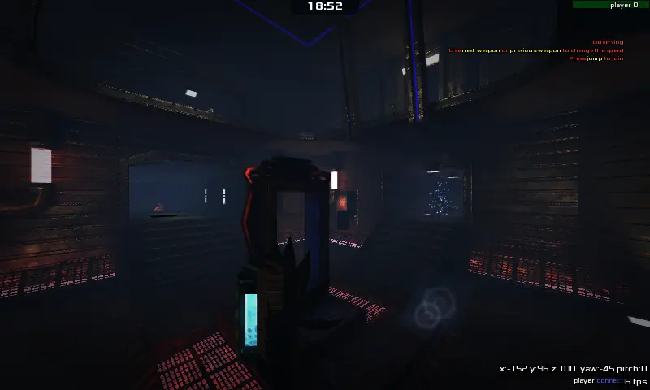
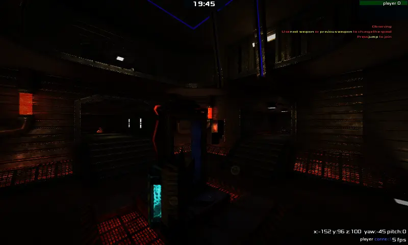

# Native map settings evidence

Scope: `mapinfo.load.loadmap` and `mapinfo.settemp.per_gametype`. The upstream Xonotic data and QuakeC pin is `863cd3e8456e18f577f7fe5fef857ff55ae62cc0`. The probe checks the full commit hash before starting.

## Results

| Path | Observed result | Evidence |
| --- | --- | --- |
| Pinned DarkPlaces, `darkzone` then `stormkeep` | The live `darkzone` world edict carried the authored numeric fog. The next world edict had no fog field after `fog none`. | [World-edict extract](logs/fog.txt) |
| Native listen, `darkzone` then `stormkeep` | The authored fog and the sky and bloom defaults applied on `darkzone`. Switching maps restored the usual sky and bloom settings and cleared depth fog. | [Headless environment checks](logs/fog.txt) |
| Native listen with `r_sky 1` and `r_drawfog 0` | The explicit sky and depth-fog preferences took precedence. The renderer still parsed the map fog value and the bloom default still applied. | [Headless environment checks](logs/fog.txt) |
| Native remote with the default cvar and with explicit opt-out | The dedicated server supplied authoritative fog parameters. The client kept all three conflicting mounted visual switches. | [Dedicated ENet checks](logs/server-visual-suggestions.txt) |
| Native remote with opt-in | The client applied all three server suggestions. The join still opened Welcome with `cl_welcome 1`. | [Dedicated ENet checks](logs/server-visual-suggestions.txt) |
| Native remote with opt-in and explicit local settings | Explicit sky, bloom and depth-fog preferences took precedence over the suggestions. Toggling the Effects checkbox in a separate client applied and then withdrew suggestions live. | [Dedicated ENet checks](logs/server-visual-suggestions.txt) |
| Native remote with a live ACL change | Tightening the local ACL withdrew the server's sky and depth-fog suggestions while keeping its bloom suggestion. Loosening restored both without reloading. | [Dedicated ENet checks](logs/server-visual-suggestions.txt) |
| Two simultaneous native peers | Both initially received ClientInit without a suggestion tail. One opted in and received the three switches, then withdrew and received an empty update. The other stayed opted out and received no values. | [Wire and render checks](logs/server-visual-suggestions.txt) |
| Native version and tail handling | The server rejected the v27 sign-on hash with a build mismatch. An opted-in v28 client kept its mounted defaults when the relay removed or corrupted the optional byte. | [Wire and render checks](logs/server-visual-suggestions.txt) |
| Native remote rotation and reconnect | The same dedicated server changed from `darkzone` to `stormkeep`. The client reconnected at the same address, cleared the previous suggestions, used mounted bloom and applied the server's `fog none`. | [Dedicated ENet checks](logs/server-visual-suggestions.txt) |
| Both dedicated servers, `_hudsetup` then `stormkeep` | `bot_number` and `minplayers` read `0/0` on `_hudsetup`, then returned to the operator baseline `3/4`. | [Paired console extract](logs/server-settemp.txt) |

The logs report both parsed values and environment assertions. In the remote `stormkeep` case, the nonzero density line comes from the local fallback before authoritative `fog none` clears `FogEnabled`. The following assertion checks the final environment state. The DarkPlaces checks inspect server state. No DarkPlaces or headless viewport capture is included.

## Native rendered pixels

The two 800×480 frames came from a windowed Godot Mono 4.6.3 native listen client using software OpenGL compatibility rendering under Xvfb. Both use `darkzone` and the same stationary observer at `-152 96 100`, yaw `315`, pitch `0`. The second run adds `--cvar r_drawfog 0`. Animation, timers and HUD text can vary between runs.

| Authored fog | Explicit local fog off |
| --- | --- |
|  |  |

## Fixtures

- [Host `darkzone.mapinfo`](fixtures/host/maps/darkzone.mapinfo) declares `.31 .27 .41 .63 .79 32 4096` fog and sets `r_sky 0` for all modes and `r_bloom 1` through the `ffa` alias for Deathmatch.
- [Host `stormkeep.mapinfo`](fixtures/host/maps/stormkeep.mapinfo) declares `fog none` and leaves the client defaults unset.
- For the dedicated tests the [probe](probe.sh) adds `r_drawfog 0` for Deathmatch to its disposable copy of the host `darkzone.mapinfo`. It also adds a contradictory CTF value and an attempted assignment to the opt-in cvar.
- [Remote `darkzone.mapinfo`](fixtures/remote/maps/darkzone.mapinfo) supplies opposite values for all three visual switches and no fog parameters. [Remote `stormkeep.mapinfo`](fixtures/remote/maps/stormkeep.mapinfo) supplies deliberately conflicting fog parameters and a mounted bloom value.
- The paired dedicated test uses the shipped `_hudsetup.mapinfo` inside `data/maps/_hudsetup.pk3`. Its `settemp_for_type all bot_number 0` and `settemp_for_type all minplayers 0` directives override the two operator values for that map. The shipped `stormkeep` sidecar has neither directive.

The pinned DarkPlaces runtime uses a dedicated executable with SHA-256 `35b40b973d7e83d75bab026b2707bf80660840421b1e12fcfe0e9c85cb9633ea`. PIN-built `progs.dat` has SHA-256 `c4a5a9e85598333568183779c06446b2d03f056d2da71636b6f86150ed1202f7`. The maps come from the repo's installed `data/maps` packs.

## Reproduce

From the repository root, build the Godot host and run the [probe](probe.sh). Supply Godot Mono, a DarkPlaces dedicated executable, the pinned `xonotic-data` checkout, and a directory containing `progs.dat` compiled from that checkout. Xvfb provides the windowed Welcome and reconnect checks. The probe creates disposable user roots and connects on localhost. It disables public listing and the pinned server's player-stat endpoints. Use a free base UDP port and the following two ports. The probe uses Python 3 for a loopback packet relay.

```sh
dotnet build VortexArena.csproj --no-restore
bash planning/parity/map-settings/probe.sh "$godot" "$darkplaces" "$pin" "$bytecode" 28580
```

The probe inspects each stock world edict, polls the cvars on both sides of the two dedicated map changes, and runs [render-state.gd](render-state.gd) against native listen and remote clients. The remote clients join the same dedicated ENet server, which rotates once at the end of the probe. The loopback relay inspects actual per-peer ClientInit tails and substitutes an absent or malformed tail for the two fallback runs. It also substitutes the exact v27 build-parity hash in a native sign-on request, computed with the same registered effects and notifications. It prints the directory holding the raw reproduction logs. The checked-in extracts contain only the relevant assertions, fog values and console cvar output.

To reproduce the actual pixels, set `run` to the directory printed by the probe. The following windowed capture uses the same mounted fixture and camera. It requires Xvfb and writes two PNGs under that disposable directory.

```bash
export DOTNET_ROLL_FORWARD=Major VORTEX_NO_MASTER_QUERY=1 LIBGL_ALWAYS_SOFTWARE=1
export VORTEX_USERDIR="$run/host" XDG_DATA_HOME="$run/xdg"
for preference in authored local-off; do
  extra=()
  if [[ $preference == local-off ]]; then extra=(--cvar r_drawfog 0); fi
  xvfb-run -a -s '-screen 0 1024x768x24' "$godot" --path "$PWD" \
    --rendering-method gl_compatibility --render-thread safe --audio-driver Dummy \
    --resolution 800x480 --map darkzone --gametype dm --observe '-152 96 100 315 0' \
    --screenshot "$run/$preference.png" --screenshot-frames 45 --no-save-config \
    --cvar vid_fullscreen 0 --cvar vid_width 800 --cvar vid_height 480 \
    --cvar cl_precache_all_weapons 0 --cvar cl_frameprofiler -1 "${extra[@]}"
done
```

## Protocol boundary

The stock `clientsettemp_for_type` path is server-authored command text. At the pin, `common/mapinfo.qc:1293–1312` selects active-mode directives and `_MapInfo_Parse_Settemp` forms `cl_cmd settemp` lines. `server/client.qc` sends those lines at connect. The native protocol owns its wire format and build gate. Legacy DarkPlaces compatibility is a separate client stack with an untrusted QuakeC boundary. Native downloadable client code has its own presentation sandbox and consent flow. That flow does not authorize native map metadata to write host cvars or dispatch commands. [ADR-0005](../../decisions/ADR-0005-custom-netcode.md), [ADR-0011](../../decisions/ADR-0011-protocol-ecosystem-boundary.md), [ADR-0019](../../decisions/ADR-0019-legacy-compatibility-mode.md), [ADR-0020](../../decisions/ADR-0020-wasm-sandbox-csharp-guests.md), [mod offer and consent](../../specs/modding.md#9-how-a-server-offers-a-mod-manifest-offer-protocol-download-consent).

The native Effects checkbox **Use server map visual suggestions** writes the archived client cvar `cl_accept_server_map_visuals`. Its default is `0`. Opting in subscribes the peer to the server's map-local suggestions for the current mode. Clearing the checkbox withdraws them locally and sends a revocation. The client discards values received while opted out, including any reply already in flight. The local ACL is evaluated live for received suggestions. Mounted map defaults use the ACL sampled at map load. A denied or missing suggestion falls back to the mounted default for that field. Explicit player settings for `r_bloom`, `r_sky` and `r_drawfog` take precedence throughout. [ADR-0018](../../decisions/ADR-0018-config-layer.md).

The host resolves its authored sidecar and one level of mounted includes with the existing map-settings ACL. The client sends one boolean on a dedicated reliable subscription opcode. The server uses a per-peer subscription to decide whether to include the optional one-byte ClientInit tail for the three booleans. Each new connection starts unsubscribed. An absent or invalid tail leaves the mounted defaults in effect. The render binding discards suggestions on teardown. The existing authoritative fog parameters and Welcome handshake retain their own fields. The suggestions supply the depth-fog visibility switch only.
