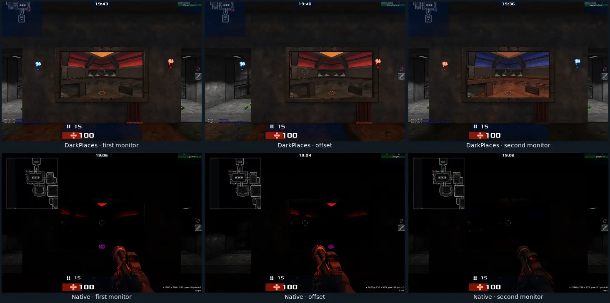
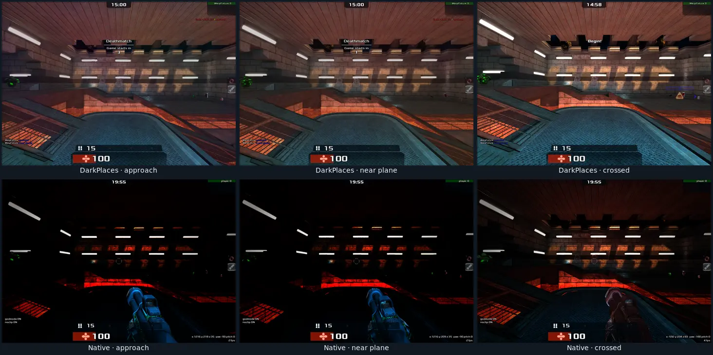
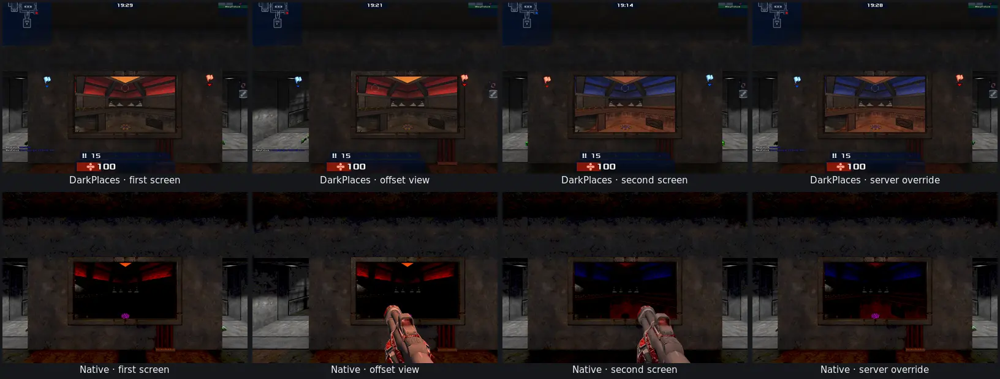
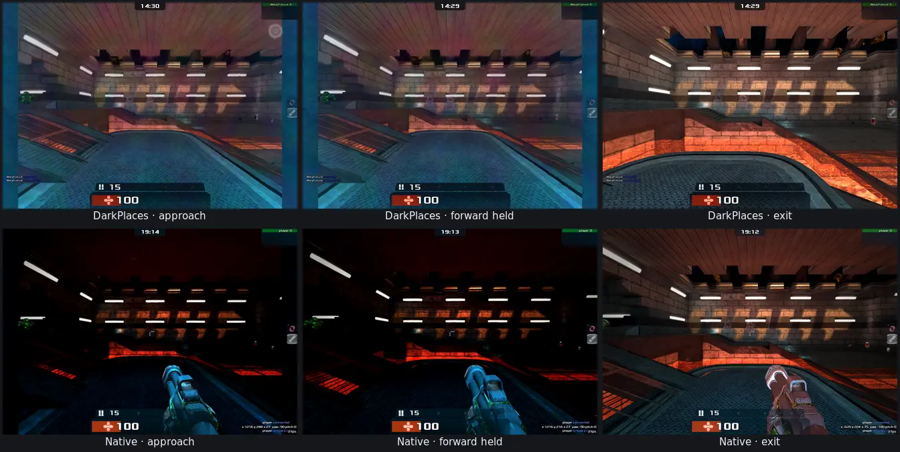

# Warpzone view and Courtfun cameras

Audited 2026-11-19 against `/tmp/vortex-parity-base` at `863cd3e8456e18f577f7fe5fef857ff55ae62cc0`. The native entries are `warpzones.client.fixview` and `warpzones.camera` in the [warpzones registry](../registry/warpzones.yaml).

## Pinned source leads

| Source | Behavior checked |
|---|---|
| `client/view.qc:1727–1748` | Spectator and event chase feed view lock, then `WarpZone_FixView` runs every view update. The only call-shaped reference to `WarpZone_FixPMove` is commented out. |
| `common/mapobjects/trigger/jumppads.qc:923–975` | `target_push_init` records angles. `target_position` and `info_notnull` end there. Only `target_push` applies push setup and can clear `.angles`. |
| `lib/warpzone/client.qc:8–21,82–129` | A fixed camera carries model index, bounds, scale, target origin and angles. Predraw gates its visibility by PVS and optional fade. |
| `lib/warpzone/client.qc:152–277` | Exterior-model hiding saves and restores the existing value, with a chase exception. FixView uses the rendered origin and angles. Four corners are unprojected at `1.125 * r_nearclip`, and the eye moves along the normal by the deepest negative plane distance while still on the entry side. The living roll factor is `max(0, 1 - frametime * cl_rollkillspeed)` with default 10 and an immediate zero when the cvar is 0. There is separate dead-view ramping and a persistent engine view-angle write. |
| `lib/warpzone/common.qc:76–94,98–165` | The fixed-camera callback uses the target origin and its own angles. Warpzone lookups use the brush query when available. |
| `lib/warpzone/common.qh:4` | The pinned build leaves `KEEP_ROLL` undefined. |
| `lib/warpzone/server.qc:264–291,451–496,677–711,785–804` | The brush defaults to `SOLID_BSP`, has no player touch effect, and resolves a named view target after map spawn. Spawnflag 1 tracks target motion. A reconnect can pick a new target. `func_warpzone_camera` is the client-side classname at this pin. The native mapper alias remains accepted. |

The local DarkPlaces SDL binary exposes `VM_CL_unproject`, `R_Water_ProcessPlanes`, and `R_SetupShader_Surface`. The paired engine runs below verify the visible fixed monitor and seam behavior. The local data checkout contains QuakeC and shaders. DarkPlaces C source was unavailable locally, so projection internals are recorded as source leads and the executable comparison is the engine evidence.

## Authored maps and native precursors

The installed BSP entity lumps and loose map companions were scanned in map order. `bromine`, `erbium`, `finalrage`, `geoplanetary`, `glowplant`, `runningman`, `runningmanctf`, `space-elevator`, and `stormkeep` have paired warpzone brushes. Courtfun has the only compiled `func_camera` entities found. `maps-src/` is empty in this worktree. Courtfun models `*7` and `*19` each have one `textures/common/camera` face with 0-to-1 UVs. The mounted `shared.pk3/scripts/common.shader` marks it `dp_camera`. Each model also has a caulk brush with the BSP solid content bit. The BSP points `target_position1` and `target_position2` specify both a position and a yaw.

Before edits, `NetGame.UpdateCamera` called `FirstPersonView.UpdateView` and already transformed the rendered eye and facing through a straddled zone on a listen host. The native first-person path already excludes the local exterior body from the camera. Predicted crossings already reach `EntityMovementStep` → `TriggerTouch.PredictWarpzonesAmbient` → `NetGame.ConsumePredictedFixAngle`. The June and July precursors include the live ambient portal pass (`b1c084e2`), the first-person fix-up (`493c8760`), the input rotation and correction work (`0d2fc0ae`, `9431ac4e`) and the crossing smoothing pulse (`aa46f3eb`). The existing view fix enlarged `Camera3D.Near` after a crossing and left a front-side eye in place when its near plane cut into the portal. The existing camera spawn function incorrectly installed a player-facing touch trigger and queued the brush for warpzone linking. It never supplied a monitor feed. The native passive target alias also cleared the authored yaw.

ADR-0001 sets the native rewrite and parity goal. ADR-0007 and ADR-0009 keep entity state and simulation contracts in Common. ADR-0016 identifies compiled maps as content build output. ADR-0005, ADR-0011 and ADR-0019 keep native networking separate from DarkPlaces signon and CSQC. The initial listen-host pass uses the existing warpzone manager and camera renderer. The remote follow-up below adds a native monitor pose message and a client-side map view.

## Graphical checks

Both engines used the installed compiled Courtfun and Stormkeep maps and local loopback sessions. Small temporary entity overlays supplied only probe destinations. The maps, monitors and portal brushes came from the original BSPs. DarkPlaces used Xonotic SDL June 20, 2023 with the pinned `progs.dat` and `csprogs.dat`. Native used Godot 4.6.3 .NET Compatibility on llvmpipe. Each window was 1000 × 700.

| Input | SHA-256 |
|---|---|
| DarkPlaces SDL | `79e38b239b8dc5d5ee1ac8ada8245a51381ce27277dc165645fea0e69fed4312` |
| PIN `progs.dat` | `c4a5a9e85598333568183779c06446b2d03f056d2da71636b6f86150ed1202f7` |
| PIN `csprogs.dat` | `cbc9fd9a4e2c7fc8f02f4aab6e5883e549790eb24e71be2bc0b8a0b0fea89999` |
| Courtfun PK3 | `e23fed73330122145c3aaa471d0f2123dd8c482e4c2ea28189c27584086aa321` |
| Stormkeep PK3 | `8d08dc53313b34c32ce669f38e630d264a0cc0698ef703235f759d6b9d6f7dd2` |

**Courtfun.** The native game built two live monitor surfaces. At the front and offset viewer positions the first camera kept its fixed red-room view from `1280 -384 404` at yaw `-44.451908°`. The second showed the opposite blue room from `-5376 4352 404` at yaw `135.548096°`. The stock feed stayed anchored to the authored UVs when the viewer moved sideways. The native probe set only the viewer transform after ordinary listen-host signon and allowed the existing portal and PVS passes to follow it. The DarkPlaces probe used `cmd teleporttotarget` and noclip. Approximate matching viewer positions in Quake coordinates were `512 -3100 363` and `420 -3100 363`, yaw 90°, and `-4608 7068 363`, yaw −90°. The native viewpoint logs and offscreen camera captures provide the fixed-aim check independent of viewer framing.

[Native viewport feeds with gamma raised for inspection](courtfun-native-feeds.webp)

**Stormkeep.** In both clients, `cmd teleporttotarget` placed the player facing the entry plane at `y=208`, with feet at `1216 218 8`, `1216 208.5 8`, and `1216 207.5 8` at yaw −90°. At the middle point the native log showed the rendered eye at `1216 209.125 35`. The surface still showed the exit room. Before the close-range projection change the subview stayed frozen at a near value of 10.50 and the monitor showed a blurred sliver of its stale image. The final pass rendered live with near 1.625 at that same point. At the third point the gameplay crossing settled the eye at `-592.5 224 83` at yaw 180°. All three stock images and all three final native images show the same exit room in the same direction. Discrete screen captures and cheat destinations verify those poses. They do not measure the temporal quality of a full-speed crossing.

[Native Stormkeep near-plane view before and after the close-range projection change](stormkeep-close-before-after.webp)

## Test coverage and limits

- `dotnet build VortexArena.csproj --no-restore` passed with existing warnings. The test host needed `DOTNET_ROLL_FORWARD=Major` for the local .NET runtime.
- The warpzone and jumppad filter passed 45 tests. The final full suite passed 6,215. The new tests exercise the registered spawn path, deferred pose, fixed and moving target behavior, reconnect, solid brush without a touch handler, and corner penetration before the eye crosses the plane.
- Brush overlap for native render view still uses AABBs. Irregular or overlapping brush volumes can differ from the pinned brush query. The seam roll change applies to the living rendered seam frame. The stock persistent client-angle accumulator, the dead-view ramp and the explicit exterior-model cvar transition remain unverified or absent. Native ordinary first person continues to hide the body through its existing per-view rendering path. The dormant QC `FixPMove` helper requires no second movement path.
- Runtime fade, reconnect visibility suppression, and rendered motion or scaling of the monitor brush itself remain open. The native editor mesh builder and legacy mode were outside this check.
- The Compatibility captures show darker native lighting than stock and a brightness change at the warpzone crossing. The monitor feed can show the native missing-texture marker for a pickup. The pictures verify room, orientation, surface anchoring and close-range continuity. They do not establish colour, exact frustum, or latency parity.

## Separate client and dedicated server

The pinned server assigns the monitor brush a SendEntity callback and chooses its target after spawn. `WarpZone_Camera_Send` sends the inline model index, bounds and scale, target origin and angles, and optional origin and fade fields. The remote `ENT_CLIENT_WARPZONE_CAMERA` handler restores the model index, installs the fixed transform and sets a PVS/fade predraw callback. The map shader marks the monitor face `dp_camera`. Its view comes from the chosen target, independently of the viewer. See `lib/warpzone/server.qc:264–291,451–496,677–696`, `lib/warpzone/client.qc:82–129`, and `lib/warpzone/common.qc:76–94` at the pinned revision.

Courtfun models `*7` and `*19` each point to one passive `target_position` in the compiled BSP. With the same compiled map mounted, a pure native client already has both poses and the screen UVs. The common baseline comes from the embedded entities even when the client and server have different loose `.ent` replacements. Ambiguous targets, moving targets and targets the engine spawns or changes at runtime can require the server’s resolved pose.

The server sends an authoritative overlay keyed by inline model index during sign-on and when that overlay changes. Missing baseline models are explicitly suppressed. An empty update restores the baked state after the last override goes away. Each reliable control 35 chunk holds up to 48 entries and uses at most 1,299 bytes including its control byte. Strictly increasing nonzero 16-bit model numbers bound a complete set to 65,535 records. The receiver applies a replacement at the final valid chunk and drops incomplete state on reconnect. Courtfun’s unchanged stock pose produces no camera packets. Protocol v28, control 34, the ClientInit visual suffix and Welcome retain their existing encoding.

Stormkeep’s static pair uses a one-sided target link. The pure client reconstructs it from the mounted brush geometry and targets for the portal renderer and eye correction. The view manager installs no gameplay entities and the actual crossing still uses the server’s normal trigger and existing angle correction. Remote transit portals whose transforms move or are rewired by the server remain open, as do Porto portal discs, monitor fade and live changes to a monitor brush’s geometry. The renderer keeps its six-subview cap. The override lane addresses cameras whose surfaces are present in the mounted map, with one monitor brush per inline model identifier.

The repeatable [loopback fixture](reproduce-remote.sh) stages entity replacements and raw frames under a caller-supplied temporary directory. Run it from the repository root under Xvfb with the engine paths supplied in the script’s environment variables. It reuses the original Courtfun viewpoints. The mixed-entity case points the server’s first monitor at the blue-room target while the native client’s separate replacement specifies yaw 120° at the original red-room location. The Stormkeep fixture places the single player spawn at `1216 248 8`, facing yaw −90°. It holds the normal forward bind to move through the original brushes.

The native build passed. The focused warpzone, visual-subscription, Welcome and scripted entry tests passed 68 checks, including a 49-entry overlay across two chunks, explicit suppression and clearing, rejection of malformed payloads, and the asymmetric Stormkeep link. The full test suite passed 6,294 checks. A separate native server recorded a real moving Stormkeep crossing from `1216 198.5 -7.97` to `-601.5 224 40.03`. It turned both velocity and view by 90°, with speed 360 units/s before and after. The graphical client showed the exit room before the server crossing, then faced into the room after the authoritative yaw-180° correction.

Both reference clients connected to separate pinned DarkPlaces dedicated servers. The restored SDL, server QC and client QC binaries matched the SHA-256 values above. The native client used the existing observer pin for the three monitor viewpoints, with the eye at Z 390. DarkPlaces used the existing teleport destinations. The dedicated native server emitted zero monitor pose updates in the stock case and one pose override during sign-on in the mixed-entity case. The native first monitor displayed the blue-room target selected by the server despite the different client `.ent`. The second monitor kept its stock feed.

Both Stormkeep clients crossed under normal forward input from the same controlled spawn. The before, held-forward and exit frames show the corresponding exit room. The screen samples come from live windows and their times are independent, so they support view and crossing checks without measuring latency or frame-level synchronization. For readability, the native Courtfun tiles use a gamma adjustment of 2.4 and the native Stormkeep tiles use 1.65. Lighting, viewmodel and missing-texture differences remain visible.

